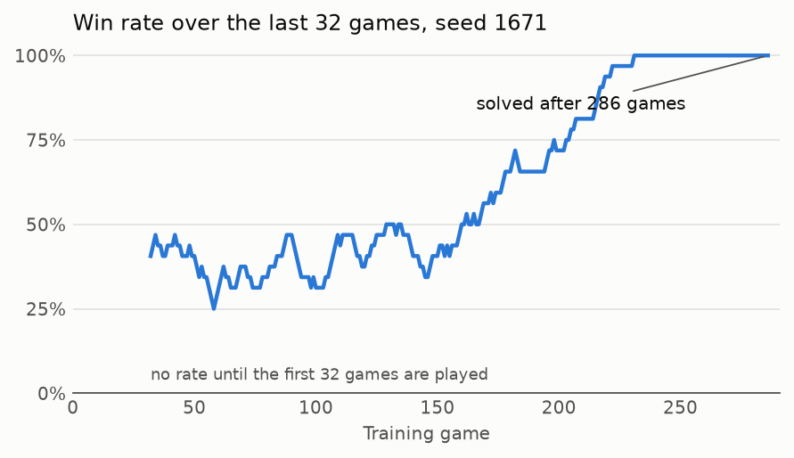
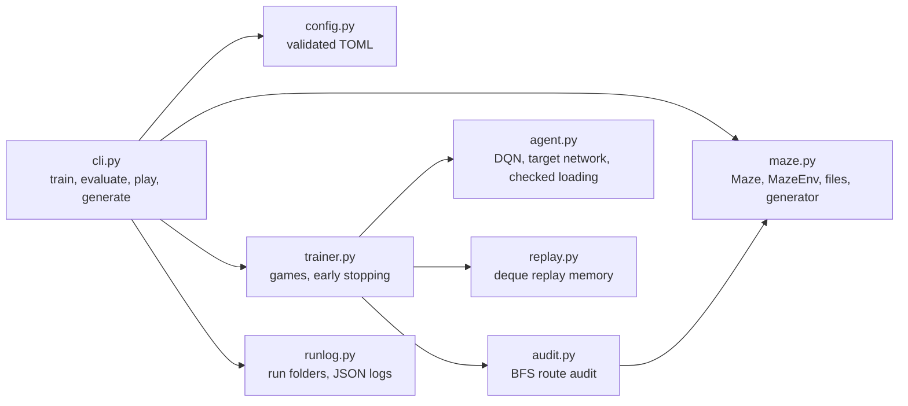
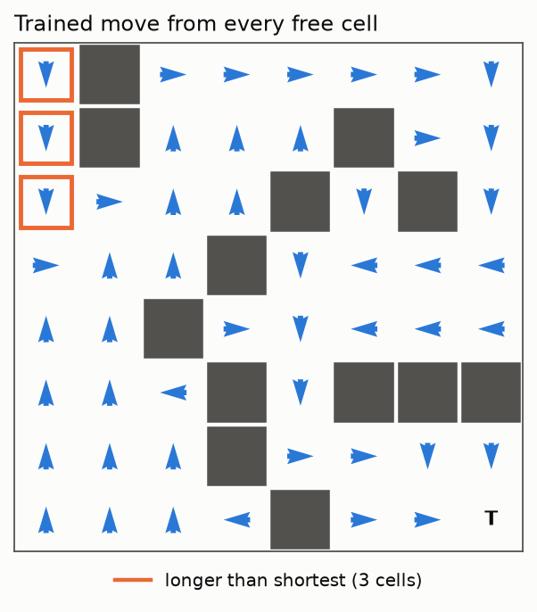

# Pirate Agent

A deep Q-learning pirate that learns to reach the treasure in a maze from every open cell, rebuilt
from my CS 370 Project Two notebook into a tested, configurable and secured Python package. This is
Enhancement One (software design and engineering) of my CS 499 Computer Science Capstone.

The original notebook and SNHU starter files are in [`original/`](original/), unchanged, so every
change below can be compared with the code that was graded.

| | CS 370 notebook | This package |
|---|---|---|
| Structure | one notebook, global `model` and `epsilon` | 8 modules, no global state |
| Mazes | one hard-coded 8 x 8 maze | `.maze` files and a solvable-maze generator, all validated |
| Settings | globals and magic numbers | one TOML file, every key type- and range-checked |
| Early stopping | `patience = 10` declared, never read | stops a stalled run after `patience` games |
| Trained model | never saved | `.keras` file, SHA-256 checked before every load |
| Tests | none | 132 automated tests, run by CI on every push |
| Dependencies | Keras unpinned (ran 3.4 to 3.5) | pinned; 19 known advisories down to 0 |
| Reference run (seed 1671) | 384 games, 179.9 s (6.43 ms per move) | 286 games, 22.4 s (1.13 ms per move), same laptop |

## Quick start

```
python -m venv .venv
.venv\Scripts\activate                 # Windows; on macOS or Linux: source .venv/bin/activate
python -m pip install -r requirements-dev.txt
python -m pip install -e . --no-deps   # makes pirate_agent importable from anywhere
python -m pytest                       # 132 tests, about ten seconds
```

Then train, check and watch an agent:

```
python -m pirate_agent train --config configs/default.toml
python -m pirate_agent evaluate --run pretrained/cs370-seed1671
python -m pirate_agent play --run pretrained/cs370-seed1671 --start 0,0
python -m pirate_agent generate --rows 8 --cols 8 --seed 3 --out mazes/new.maze
```

The install also adds a `pirate-agent` command, so `pirate-agent evaluate --run ...` works too.

<picture>
  <source media="(prefers-color-scheme: dark)" srcset="docs/images/training-curve-dark.png">
  
</picture>

## Commands

| Command | What it does | Exit codes |
|---|---|---|
| `train --config FILE [--seed N]` | Trains a new agent and writes a run folder under `runs/` | 0 done, 3 bad input |
| `evaluate --run DIR` | Loads a run's model through the checked loader and audits it from every free cell | 0 all cells win, 3 bad input, 4 model refused, 5 audit failed |
| `play --run DIR --start ROW,COL` | Draws the trained pirate's route from one cell | 0 won, 3, 4, 5 as above |
| `generate --out FILE.maze [--rows --cols --density --seed]` | Writes a random maze in which every free cell can reach the treasure | 0, 3 |

Add `-q` for warnings only or `-v` for debug messages. Argument mistakes exit with 2.

A run folder holds `model.keras`, `history.csv` (one row per training game) and `run.json`: the
settings, seed, maze layout, package versions, results, route audit and the model's SHA-256.

## Configuration

Settings come from a TOML file such as [`configs/default.toml`](configs/default.toml). Paths are
relative to the file. Unknown keys, wrong types and out-of-range values are errors, so a typo
cannot be silently ignored.

```toml
[maze]
file = "../mazes/cs370.maze"     # or a [maze.generate] table: rows, cols, wall_density, seed

[training]
seed = 1671
patience = 300

[output]
runs_dir = "../runs"
```

| `[training]` key | Default | Meaning |
|---|---|---|
| `seed` | 1671 | Seeds Python, NumPy and TensorFlow; the same seed repeats the same run on one machine |
| `max_epochs` | 15000 | Most games to play; each epoch is one game from a random free cell |
| `memory_size` | 8 per cell | Replay memory capacity in moves |
| `batch_size` | 32 | Moves replayed per gradient step |
| `target_sync_every` | 50 | Gradient steps between target network refreshes |
| `learning_rate` | 0.001 | Adam step size |
| `discount` | 0.95 | Weight of future reward |
| `epsilon_start`, `epsilon_min`, `epsilon_decay` | 1.0, 0.05, 0.995 | Exploration schedule, restarted on every run |
| `settle_win_rate`, `epsilon_settled` | 0.9, 0.05 | Above this win rate, exploration drops straight to `epsilon_settled` |
| `target_win_rate` | 1.0 | Win rate that triggers the completion check from every free cell |
| `win_window` | half the cells | Games in the win-rate window |
| `patience` | 300 | Games without a better win rate before a run stops as stalled |
| `log_every` | 25 | Games between progress lines |

## Maze files

One line per row: `#` wall, `.` free cell, `T` treasure (bottom-right if omitted). Lines that start
with `;` are comments.

```
.#......
.#...#..
....#.#.
...#....
..#.....
...#.###
...#....
....#..T
```

A maze is accepted only if it is 2 to 32 cells on each side, rectangular, ASCII, at most 8 KiB, has
exactly one open treasure, and every free cell has a path to the treasure. Each refusal names the
line and column or the cell at fault.

## Design



| Module | Responsibility | Replaces in CS 370 |
|---|---|---|
| `maze.py` | Validated `Maze`, `.maze` parsing, the generator, the game rules | `TreasureMaze.py` |
| `replay.py` | Bounded replay memory | the list in `GameExperience.py` |
| `agent.py` | Network, Bellman targets, one compiled learning step, safe save and load | `build_model`, `train_step`, `get_data` |
| `trainer.py` | Epsilon-greedy games, the stopping rules, logging | `qtrain`, `Explorer`, `ReplayLearner`, `TargetSync` |
| `audit.py` | Breadth-first search and the route audit from every free cell | `PolicyAudit`, `completion_check` |
| `config.py` | `TrainingConfig` and the TOML loader | globals and magic numbers |
| `runlog.py` | Run folders, atomic JSON logs, history files | nothing; results were never saved |
| `cli.py` | The four commands and their exit codes | notebook cells |

Decisions worth knowing before you change the code:

- **A maze is validated once, when it is built, and is read-only afterward.** Every source goes
  through `Maze.from_grid()`, so the environment never handles a bad layout mid-training.
- **The trainer depends on a two-method protocol** (`greedy_action`, `learn`), not on TensorFlow, so
  its stopping rules are tested exactly with stand-in agents in milliseconds.
- **Only a win is terminal.** Running out of reward budget is a cutoff, not a place in the maze, so
  that move's target still looks one step ahead (a CS 370 decision, kept).
- **The deque replay memory** drops the oldest move in O(1); the starter list's `del memory[0]` was
  O(n). Measured on a full memory: 81 ns against 29 ns per insert at 512 moves, and 8,207 ns against 30 ns at 100,000.

## Security

| Input | Threat | Defense |
|---|---|---|
| Model files | Loading a crafted `.keras` file can run code (CWE-502; OWASP A08:2025, software or data integrity failures); Keras 3.5's `safe_mode` had published bypasses | Read the bytes once; SHA-256 must match `run.json`; the archive may hold only `metadata.json`, `config.json` and `model.weights.h5`; every class must be on an allowlist (no `Lambda`, no `TFSMLayer`); then a private copy loads with `safe_mode=True`. `.h5` and pickle files are never loaded. |
| Maze files | Malformed or oversized input, look-alike characters | 8 KiB cap before reading, ASCII only, strict format, full validation |
| Configuration | Silent typos, wrong types, extreme values | Unknown keys refused, booleans not accepted as numbers, every value range-checked, 64 KiB cap |
| Run logs | An edited log pointing the loader elsewhere | 1 MiB cap, schema and type checks, the model file must be exactly `model.keras` in the run folder |
| Dependencies | Known vulnerabilities (OWASP A03:2025, software supply chain failures) | Exact pins; `pip-audit --strict` in CI. The CS 370 pins have 19 advisories (18 in Keras 3.5.0, 1 in protobuf); these pins have 0. |
| Logs and output | Personal data | Paths are stored relative to the run folder; no user names or home folders |

## Tests and CI

`python -m pytest` runs 132 tests: the game rules (including regression tests for the two SNHU
starter bugs), every maze and configuration refusal, the replay memory, the route audit, the
stopping rules, the network and its learning step, the model-file attacks (a `Lambda` layer, a
renamed `.h5`, a smuggled archive entry, a changed byte), and a full train, evaluate and play cycle
on a tiny maze.

GitHub Actions runs three jobs on every push and pull request: Ruff (lint, format and Bandit
security rules) with codespell, the test suite, and `pip-audit` on the pinned dependencies.

## Results

All numbers come from [`scripts/evidence.py`](scripts/evidence.py) and
[`scripts/time_original.py`](scripts/time_original.py); the raw output is in
[`docs/evidence/`](docs/evidence/).

Training speed, all on one laptop CPU with the CS 370 seed (1671) and maze:

| Code | TensorFlow / Keras | Games | Seconds | ms per move | Cells won | Shortest routes |
|---|---|---|---|---|---|---|
| CS 370 notebook | 2.17.0 / 3.5.0 | 384 | 179.9 | 6.43 | 50 of 50 | 50 |
| this package | 2.21.0 / 3.15.1 | 286 | 22.4 | 1.13 | 50 of 50 | 47 |
| this package | 2.17.0 / 3.5.0 | 359 | 35.2 | 1.16 | 50 of 50 | 49 |

The last row runs the new code on the old libraries, so the drop from 6.43 to about
1.16 ms per move comes from the code (one compiled learning step instead of three calls
per move), not from the upgrade. Game counts repeat exactly for a seed and library version;
seconds vary by a second or two between runs.

- **Ten seeds:** 10 of 10 runs solved the maze and won from all 50 cells, with a
  median of 282 games (range 247 to 393) and 23.2 s per run. The
  stopping rule asks only for wins, so shortest routes range from 33 to 50 of 50.
- **Early stopping:** a run given a learning rate of 1e-09, which cannot learn, stopped as
  stalled after 374 games (30.7 s) instead of playing up to 15,000.
- **A generated maze** with 42 open cells was solved after 175 games in 8.2 s, winning from all
  41 starting cells.
- **Dependencies:** 19 advisories against the CS 370 pins, 0 against these.

Every table, per-seed row and advisory ID is in [`docs/evidence/SUMMARY.md`](docs/evidence/SUMMARY.md).

<picture>
  <source media="(prefers-color-scheme: dark)" srcset="docs/images/policy-dark.png">
  
</picture>

## Project layout

```
original/            CS 370 notebook and SNHU starter files, unchanged
src/pirate_agent/    the package
tests/               pytest suite
configs/             default, generated-maze and smoke-test configurations
mazes/               the CS 370 maze as a .maze file
pretrained/          the reference run on the CS 370 maze (seed 1671)
notebooks/demo.ipynb a thin demo that only calls the package
scripts/             evidence and figure scripts
docs/                evidence files and README figures
```

## Credits

The maze environment and replay memory began as `TreasureMaze.py` and `GameExperience.py`, and the
network, game loop and completion check began as cells of the starter notebook, all supplied by
Southern New Hampshire University for CS 370, Current and Emerging Trends in Computer Science. The
rest of this repository was written for CS 370 and CS 499.

Michael Soto, CS 499 Computer Science Capstone, November 2026.
